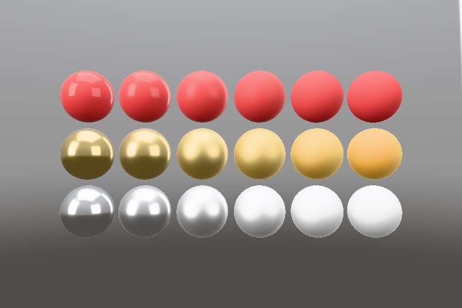

# MetalSprocketsPBR

A physically based renderer for [MetalSprockets](https://github.com/schwa/MetalSprockets). It does not depend on any file format. [MetalSprocketsGLTF](https://github.com/schwa/MetalSprocketsGLTF) loads glTF files into it.



Features: metallic-roughness materials and their extensions (clearcoat, sheen, transmission, volume, iridescence, anisotropy, and more), image-based lighting, punctual lights, skinning, morph targets, instancing, tone mapping, HDR output, and stereo/immersive rendering.

Requires macOS, iOS, or visionOS 26.

## Installation

```swift
.package(url: "https://github.com/schwa/MetalSprocketsPBR", branch: "main"),
```

```swift
.product(name: "MetalSprocketsPBR", package: "MetalSprocketsPBR"),
```

## Usage

Build a model in code:

```swift
import MetalSprocketsPBR

let device = MTLCreateSystemDefaultDevice()!

// 1. Geometry: a unit quad facing +Z. Attributes are given per semantic; missing ones get defaults.
var geometry = PBRGeometryBuilder(device: device)
let positions: [SIMD3<Float>] = [[-0.5, -0.5, 0], [0.5, -0.5, 0], [0.5, 0.5, 0], [-0.5, 0.5, 0]]
let normals = [SIMD3<Float>](repeating: [0, 0, 1], count: 4)
let quadIndex = try geometry.add(attributes: [
    .init(semantic: .position, format: .float3, values: positions),
    .init(semantic: .normal, format: .float3, values: normals),
], indices: [0, 1, 2, 0, 2, 3])
let quad = try geometry.build()[quadIndex]

// 2. A material.
let uniforms = PBRMaterialUniforms.defaults(baseColor: [1, 0, 0, 1], metallic: 0, roughness: 0.5)
let red = try PBRMaterial(uniforms: uniforms, placeholder: PBRMaterial.placeholderBinding(device: device), device: device)

// 3. Place instances by node. The rest pose holds each node's world matrix.
var builder = PBRModelBuilder(device: device, restPose: PBRPose(worldMatrices: [matrix_identity_float4x4]))
builder.addInstance(quad, material: red, node: 0)
let model = try builder.build()
```

Render it with `PBRScene`. It is a MetalSprockets `Element`, so you can use it in a `RenderView` or an `OffscreenRenderer`:

```swift
let lighting = PBRLighting(environment: .studio, toneMapping: .pbrNeutral)

PBRScene(
    model: model,
    viewMatrix: viewMatrix,
    projectionMatrix: projectionMatrix,
    lighting: lighting,
    showsBackground: true,
    viewportSize: viewportSize
)
```

Depth is reversed (near 1, far 0). Use `PBRCamera.framing` or GeometryLite3D's `PerspectiveProjection` with `.reversed` depth for projections, and clear depth to 0: `.metalClearDepth(0)` on a `RenderView`, or `OffscreenRenderer(size:clearDepth: 0)`.

To animate the model, pass a different `PBRPose` (node world matrices, morph weights, material overrides, visibility) in `pose:`. To draw many models in one scene, use `PBRScene(items:...)`.

## Modules

- `MetalSprocketsPBR`: the Swift renderer.
- `MetalSprocketsPBRShaders`: the Metal shaders and the shared shader types (`PBRVertex`, `PBRMaterialUniforms`, and others). `MetalSprocketsPBR` re-exports it.
